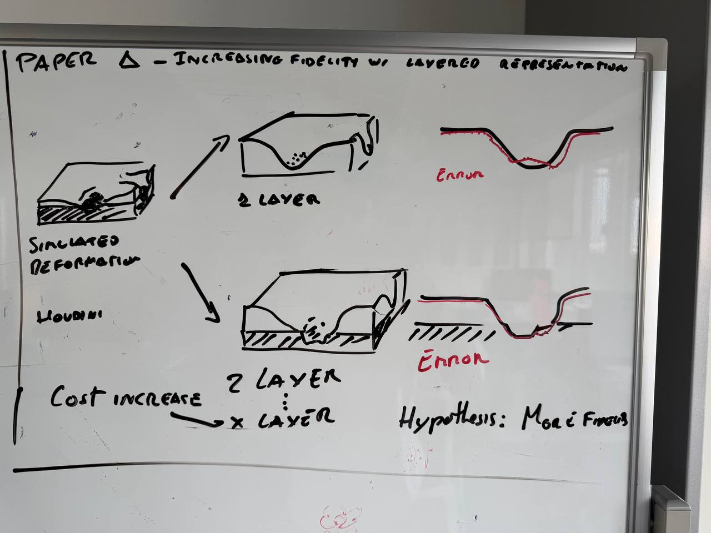
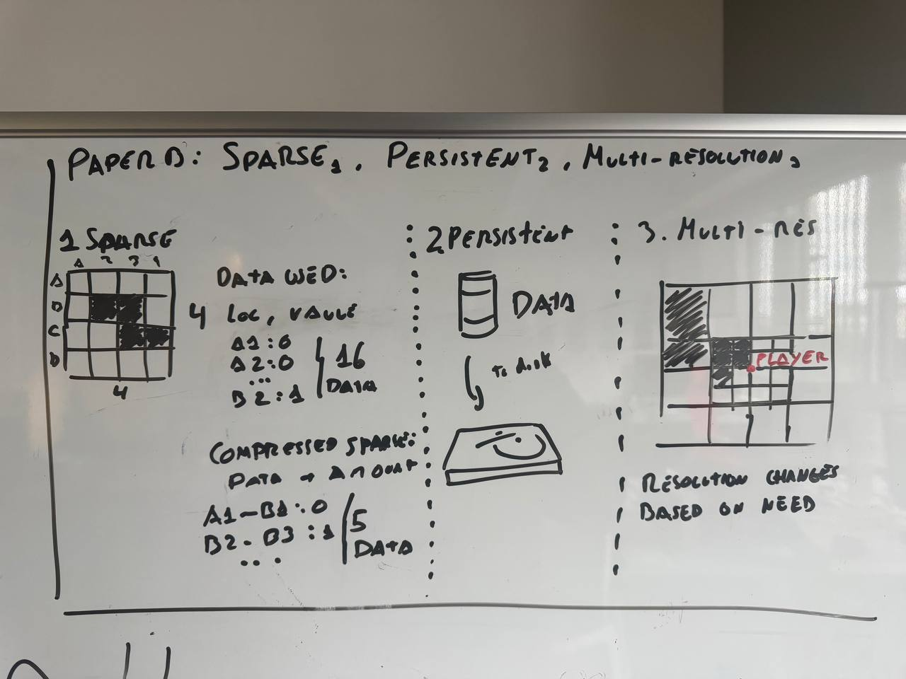
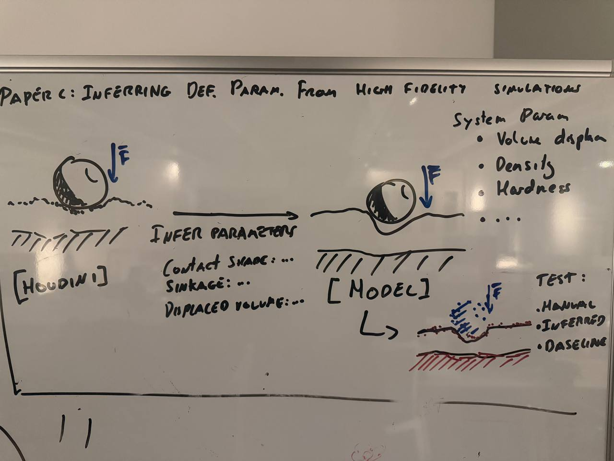

# Potential Academic Papers
Paper A: Real-time approximations of layered material deformation
Paper B: Sparse, persistent, multi-resolution data structure & optimization
Paper C: Inferring terrain deformation parameters from high fidelity simulations

## Working Title

### Real-time approximations of layered material deformation

## Research Gap

Most of the terrain deformation can be divided under the following:

- Real-time single-layer: simplify the subsurface material structure or getting rid of it altogether.
- Real-time single-layer approaches: simplify the subsurface material structure or getting rid of it altogether.
- Physically Simulated: More accurate to physical examples but generally not suited for stricter budgets (like real-time)

The multi-layered approach would give finer distinction in between different stratified materials.
This leaves a gap to investigate how a reduced layered terrain representation can approximate a stratified terrain
## Research Question
### Primary Question

Can a multi-layered material deformation system create a closer approximation to a simulated example

compared to the single-layered approach while not compromising on budget?

### Secondary Question

How does complexity and cost scale as the amount of layers and fidelity increase?

## Hypothesis

The multi-layered approach would give finer distinction in between different stratified materials.

A reduced number of layers will provide a closer resemblance to the physically simulated interaction.

As the amount of layers and resolution increase, error will decrease with it but it will lead to increased
compute times and memory allocation.

At some point the increase in fidelity will not be worth the trade-off in performance.

## Proposed Contribution

A real-time multi-layer model based on a reduced version of physically simulated models,

created with real-time in mind for generic GPU-based terrain landscape deformations. 

An analysis of trade-offs between deformation fidelity and compute budget targets.

## Evaluation

Using existing simulation tools - like Houdini - as a high fidelity numerical reference to compare 
between the two different approaches: single-layer and multi-layer.
The same controlled scenarios will be done on the following models:

1. Houdini physically based simulation
2. Single-layer terrain deformation
3. Multi-layer terrain deformation 

Then different metrics will be used as quantitative comparators.
These could be such as:

- Surface deformation error
- Indentation depth
- Compute time (ms for a given hardware)
- Memory usage
- Layer-boundary error
- Interaction with underlying layers

## Working Title
### Sparse, persistent, multi-resolution data structure & optimization

## Research Gap
Multi-layer terrain deformation system needs to work in real-time for large open worlds.  
Large open-world terrain deformation requires persistent simulation states across areas 
much larger than can be reasonably saved into the GPU memory.

Existing techniques such as sparse textures, virtual textures, tiling, GPU caching reduce memory requirements.

However, persistent terrain deformation introduces additional requirements:

- Dynamic changes over time

- Past modified regions must preserve the modified state

- Only parts of the world will be deforming
The research gap lies on how could computing only be done on active terrain while still displaying previous

deformation terrain and keep within memory budget restrictions.

## Research Question
### Primary Question
How does a sparse architecture affect:

- Compute time
- Memory allocation
- Streaming / reconstruction cost
- Simultaneous deformation

Compared to a dense terrain approach?

### Secondary Question
How should simultaneous events be scheduled under a fixed frame-time budget?

## Hypothesis
Memory will be reduced at first, but as deformations occur memory usage will increase.
The proposed architecture will see reduced GPU memory for a single case use on a localized area.

Memory will increase with activity, but it will be still better than the dense architecture.

There will be an increased overhead by constructing and deconstructing the sparse data on read / write,
but it will be better for larger terrains.

## Proposed Contribution
### Core contribution
A sparse persistent architecture for real-time terrain deformation

### Necessary mechanisms
Allocation of GPU memory for localized deformation requests / lookup, while keeping
on disk the current unused data.

### Possible research extensions
Event managing and scheduling along multiple frames if expected frame cost exceeds budget.
A multi-resolution deformation representation to allow for level of detail on distant / pre-authored areas.

## Evaluation
Comparison between dense and sparse architectures with the following tests:

- With world / tile increase
- With texture resolution increase
- Simultaneous events
- Increased material layers
- Percentage of terrain active

By checking quantitative metrics:
- GPU Memory
- GPU Time
- P95 / P99 frame time
- Streaming cost
- Disk usage
- LOD error

This way we will have quantitative metrics of how the system behaves with different scenarios
and we will be able to evaluate whether the expected behavior occurs.

## Working Title
### Inferring terrain deformation parameters from high fidelity simulations

## Research Gap
Reduced real-time terrain deformation models require significantly simpler material 
parameters, and those may not be directly correlated to high fidelity simulations. 

Manual tuning is subjective and time-consuming, so a model that can map between
terrain properties and parameters of the terrain deformation model is needed.

## Research Question
### Primary Question
Can the parameters of a reduced real-time terrain model be automatically inferred from the deformation behavior produced by high-fidelity material simulations?

### Secondary Question
How well do inferred parameters extend to unseen interactions?

## Hypothesis
From already existing high fidelity simulations a set of parameters will be inferred.

Inferred parameters will have a lower error compared to generic terrains when held
against high fidelity simulations and should require less human tuning time.

## Proposed Contribution
A calibration method that is capable of transforming high fidelity simulation data
into reduced real-time terrain deformation parameters.

## Evaluation
Compare the error between:
- High fidelity simulation baseline
- Inferred parameters
- Manual tuning

Do they work on interactions they were not calibrated on?
Is automatic calibration better and faster than manual tuning?

Comparison scenarios:
- Unseen loads
- Single deformations
- Accumulated deformations

Quantitative metrics:
- Surface deformation error
- Indentation depth
- Layer-boundary error
- Interaction with underlying layers
- Calibration time (human vs inferred)

